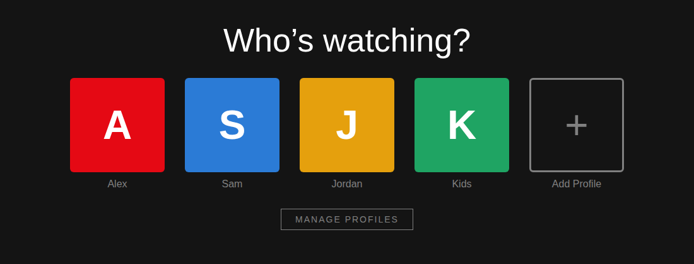

<div align="center">

# 🎬 Homeflix

### Your movies. Your music. Your couch. No subscription.

**A streaming service for your own media library, in one Python file.**

No Docker. No database. No account. No `pip install`. Just `python3 homeflix.py`. Linux, macOS and Windows.


</div>

---

<p align="center">
  
</p>

You already own the movies, the shows and the albums. They're sitting in a folder named `Downloads` with filenames like `The.Show.S02E07.1080p.WEB.x265-GRP.mkv`.

**Homeflix turns that folder into a polished streaming app.** Open it on any phone, laptop or smart TV browser in your house. You get poster rows, a "Who's watching?" screen, Continue Watching, binge-ready TV seasons, and a music player that works from your phone's lock screen.

It's one file and uses nothing outside the Python standard library. You can read all of it in an afternoon, and it runs on whatever machine already has your media on it.

<p align="center">
  
  <br><sub>The player resumes where you left off, and the controls fade away while you watch.</sub>
</p>

<sub>Screenshots use a demo library of made-up titles with generated artwork.</sub>

## ✨ Why Homeflix?

| | Homeflix | Typical media server |
|---|---|---|
| **Install** | One Python file | Docker images, databases, accounts |
| **Dependencies** | Python standard library (ffmpeg optional) | Dozens of packages and services |
| **Phones home?** | Never. No telemetry, no cloud login | Often requires an online account |
| **Runs on** | Linux, macOS, Windows | Varies |
| **Client apps** | Any web browser | Often platform-specific apps |
| **Auditable** | ~1,500 lines you can actually read | Hundreds of thousands |

## 🍿 What you get

### A streaming-app experience for your own files
- **"Who's watching?" profiles.** Everyone in the house gets their own watch history and **My List**.

  <p align="center"></p>

- **A home screen worth scrolling.** Hero banner, **Continue Watching**, My List, Recently Added, TV Shows, Movies, New Music and genre rows.
- **Instant search.** Press `/` and type. It searches titles, shows, artists and albums.

### TV shows that just work
- Episodes are **grouped into shows and seasons automatically**, from `Show.Name.S01E02.mkv` or `Show/Season 1/1x02.mkv`.
- Season pickers, per-episode progress bars, and **next-episode autoplay** for binge nights.

### Messy filenames, cleaned up
- `Movie.2010.1080p.BluRay.x264-YIFY` shows up as ***Movie (2010)***.
- `Inception (2010)/movie.mkv` uses the folder name.
- Thumbnails are grabbed from each video automatically in the background. Drop a `poster.jpg` next to a file to use your own art.

### Plays (almost) anything
- **Direct streaming** with instant byte-range seeking for browser-friendly files (H.264 / VP9 / AV1 in MP4, MKV, WebM).
- **Converted as it plays** with ffmpeg for everything else: HEVC/x265, AVI, WMV, old MPEG-4, ALAC, WMA and more. Seeking still works.
- **HEVC/x265 in original quality** on devices that can decode it (iPhone, iPad, Mac, many Android phones and TVs). The video is passed through untouched, with no re-encoding.
- **High-quality conversion by default**, with three levels to match your CPU and network: `balanced`, `high` and `max`.
- **Subtitles:** sidecar `.srt`/`.vtt` files (`Movie.en.srt`, `Subs/` folders) plus text subtitles embedded in MKVs.

### A real music player, too
- Albums are built from your tags, with folder structure as the fallback.
- Cover art is taken from embedded artwork or `cover.jpg` / `folder.jpg`.
- A **persistent player bar** with shuffle and repeat that keeps playing while you browse.
- **Lock-screen and media-key controls** on phones.

<p align="center"></p>

### Keyboard-first player
`Space` play/pause · `←` `→` skip 10s · `↑` `↓` volume · `F` full screen · `M` mute · `N` next episode · `Esc` back

## 🚀 Up and running in 60 seconds

Homeflix runs on **Linux, macOS and Windows**. The installer sets it up and gives you a `homeflix` command. Nothing runs in the background unless you ask for it.

### Linux and macOS

```bash
git clone https://github.com/crash101g/homeflix.git && cd homeflix
bash install.sh
```

### Windows

Download the repo (**Code → Download ZIP**), unzip it, and double-click **`install.cmd`**.
Or, in PowerShell:

```powershell
git clone https://github.com/crash101g/homeflix.git; cd homeflix
powershell -ExecutionPolicy Bypass -File install.ps1
```

### What the installer does

- installs ffmpeg if it's missing (apt/dnf/pacman on Linux, Homebrew on macOS, winget on Windows). On Windows it can also install Python.
- copies the app to `~/src/homeflix` (Windows: `%LOCALAPPDATA%\Programs\Homeflix`)
- asks for your port, media folders and an optional password
- adds a `homeflix` command that runs the app with those settings
- offers to open the firewall port **to your local network only** (UFW on Linux, Windows Firewall on Windows)

Start Homeflix when you want it:

```bash
homeflix            # Ctrl+C to stop. Flags like --quality max work here too.
```

Then open **`http://<your-PC-IP>:8484`** on any device in the house. That's it.

> **macOS:** the first time, macOS asks whether Python may read folders like Downloads or Music and accept incoming connections. Click **Allow** both times.
>
> **Windows:** open a new terminal after installing so the `homeflix` command is found. If Windows asks whether Python can use the network, allow it on private networks.

### Want it as a service?

Running it yourself is the default. If you'd rather have it in the background, re-run the installer with one of these options. Linux uses a systemd user service, macOS a launchd agent, and Windows a Task Scheduler task.

| Linux / macOS | Windows | What it does |
|---|---|---|
| `bash install.sh --service` | `install.cmd -Service` | Runs Homeflix in the background now. It does **not** start at login. |
| `bash install.sh --autostart` | `install.cmd -Autostart` | Same, but also starts it every time you log in. |
| `bash install.sh --remove-service` | `install.cmd -RemoveService` | Removes the background service. The `homeflix` command still works. |
| `bash install.sh --uninstall` | `install.cmd -Uninstall` | Removes the service and the `homeflix` command. Your settings and watch history are kept. |

The installer prints the exact start, stop and log commands for your system. They're also listed under [Where things live](#-where-things-live).

### Or just run it

No installer needed. Use `python3` on Linux and macOS, or `python` on Windows:

```bash
python3 homeflix.py                                   # ~/Downloads/movies + ~/Music on :8484
python3 homeflix.py --password 'something' --port 9000
python3 homeflix.py --videos ~/Videos --videos /mnt/nas/movies --music ~/Music
python3 homeflix.py --host 127.0.0.1                  # this PC only
python homeflix.py --videos "D:\Movies" --music "%USERPROFILE%\Music"   # Windows (cmd)
```

| Option | What it does |
|---|---|
| `--videos DIR` | Video folder (repeatable) |
| `--music DIR` | Music folder (repeatable) |
| `--host` / `--port` | Bind address and port (default `0.0.0.0:8484`) |
| `--password` | Require a password to use the app |
| `--quality LEVEL` | Quality for files that must be converted: `balanced`, `high` (default) or `max` |
| `--rescan-minutes N` | Auto-rescan interval (default 15, `0` disables) |
| `--no-thumbs` | Skip thumbnail generation |
| `--quiet` | Don't log every HTTP request |
| `--version` | Print the version and exit. The version is also shown at startup and next to the logo in the web app. |

To make a setting stick, put it in your settings file (see below), e.g. `HOMEFLIX_QUALITY=max`. Homeflix reads that file every time it starts, however you run it. Flags on the command line win over the file. If you use the service, restart it afterwards.

New files show up on their own: Homeflix rescans every 15 minutes, or right away when you press the **⟳** button.

## 🔒 Secure by design

A tool that serves files from your disk should be paranoid, so Homeflix is:

- **No path traversal, by construction.** Files are served only by opaque IDs from the scanned index. Request paths never touch the filesystem.
- **Password protection done properly.** HMAC session cookie (HttpOnly, SameSite=Lax), a 1.5-second delay on every wrong guess, and the API returns 401 until you log in.
- **Hardened frontend.** Strict Content-Security-Policy and `nosniff`, and every filename is rendered as text, never through `innerHTML`.
- **LAN-first.** The installer only opens the firewall to your local subnet.

> ⚠️ Homeflix speaks plain HTTP and is meant for a trusted home network. **Don't port-forward it to the internet.** For access away from home, use Tailscale/WireGuard or put it behind a TLS reverse proxy.

## 📁 Where things live

| What | Linux | macOS | Windows |
|---|---|---|---|
| App | `~/src/homeflix/` | `~/src/homeflix/` | `%LOCALAPPDATA%\Programs\Homeflix\` |
| `homeflix` command | `~/.local/bin/homeflix` | `~/.local/bin/homeflix` | `%LOCALAPPDATA%\Programs\Homeflix\homeflix.cmd` |
| Settings (port, folders, password, quality) | `~/.config/homeflix/env` | `~/Library/Application Support/Homeflix/env` | `%APPDATA%\Homeflix\env` |
| Profiles, watch progress, My List | `~/.local/share/homeflix/state.json` | `~/Library/Application Support/Homeflix/state.json` | `%APPDATA%\Homeflix\state.json` |
| Thumbnails, probe cache, extracted subs (safe to delete) | `~/.cache/homeflix/` | `~/Library/Caches/Homeflix/` | `%LOCALAPPDATA%\Homeflix\Cache\` |

**Service commands** (only if you installed with `--service` / `--autostart`)

| | Linux (systemd) | macOS (launchd) | Windows (Task Scheduler, in PowerShell) |
|---|---|---|---|
| Start | `systemctl --user start homeflix` | `launchctl bootstrap gui/$(id -u) <plist>` * | `Start-ScheduledTask Homeflix` |
| Stop | `systemctl --user stop homeflix` | `launchctl bootout gui/$(id -u)/com.homeflix` | `Stop-ScheduledTask Homeflix` |
| Logs | `journalctl --user -u homeflix -f` | `tail -f ~/Library/Logs/Homeflix.log` | `Get-Content -Wait $env:APPDATA\Homeflix\homeflix.log` |

\* The plist is `~/Library/LaunchAgents/com.homeflix.plist` with `--autostart`, or `~/Library/Application Support/Homeflix/com.homeflix.plist` with `--service`.

> **macOS background service and protected folders:** macOS doesn't let background apps read Downloads, Documents or Desktop. If your media is there, give Python **Full Disk Access** (System Settings → Privacy & Security; the installer prints which Python to add), or keep your media in another folder such as `~/Movies`.

## 🧰 Requirements

- **Python 3.8+** on Linux, macOS or Windows. That's the only hard requirement.
- **ffmpeg / ffprobe** (optional, strongly recommended) for thumbnails, durations, tags, embedded subtitles and converting formats browsers can't play.

## 📜 License

MIT. See [LICENSE](LICENSE).

---

<div align="center">

**Stop paying monthly to rent what you already own.**

⭐ If Homeflix turned your Downloads folder into movie night, star the repo.

</div>
