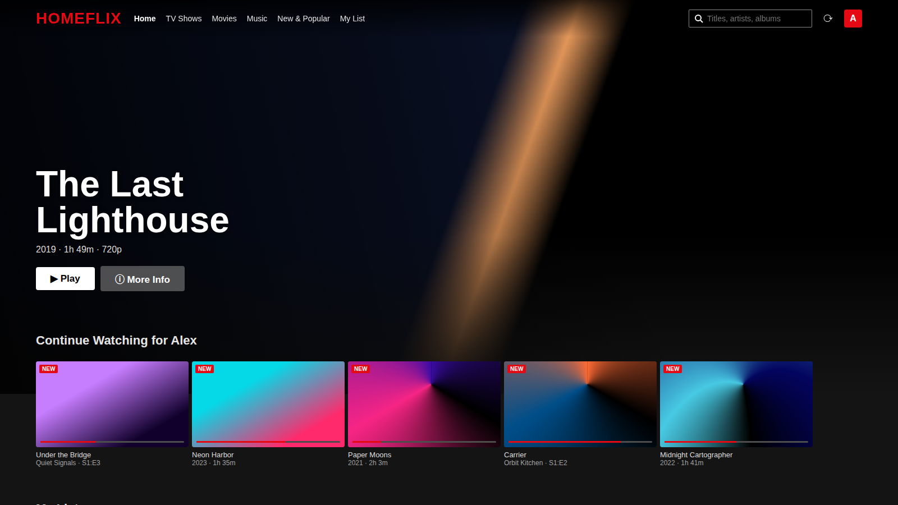
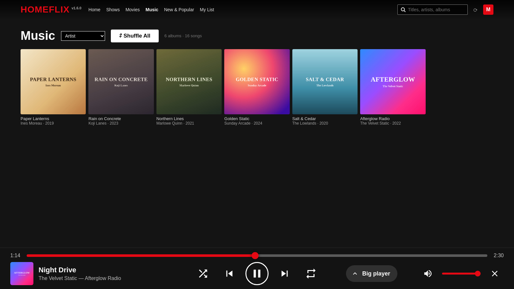
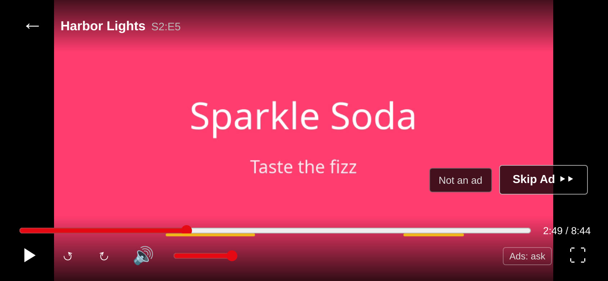

<div align="center">

# 🎬 Homeflix

### Your movies. Your music. Your couch. No subscription.

**A streaming service for your own media library, in one Python file.**

No Docker. No database. No account. No `pip install`. Just `python3 homeflix.py`. Linux, macOS and Windows.


</div>

---

<p align="center">
  
</p>

You already own the movies, the shows and the albums. They're sitting in a folder named `Downloads` with filenames like `The.Show.S02E07.1080p.WEB.x265-GRP.mkv`.

**Homeflix turns that folder into a polished streaming app.** Open it on any phone, laptop or smart TV browser in your house. You get poster rows, a "Who's watching?" screen, Continue Watching, binge-ready TV seasons, optional **commercial skipping for your TV recordings**, and a music player that works from your phone's lock screen.

It's one file and uses nothing outside the Python standard library. You can read all of it in an afternoon, and it runs on whatever machine already has your media on it.

<p align="center">
  
  <br><sub>The player resumes where you left off, and the controls fade away while you watch.</sub>
</p>

<sub>Screenshots use a demo library of made-up titles with generated artwork.</sub>

## ✨ Why Homeflix?

| | Homeflix | Typical media server |
|---|---|---|
| **Install** | One Python file | Docker images, databases, accounts |
| **Dependencies** | Python standard library (ffmpeg optional) | Dozens of packages and services |
| **Phones home?** | Never. No telemetry, no cloud login | Often requires an online account |
| **Runs on** | Linux, macOS, Windows | Varies |
| **Skips ads in TV recordings** | Yes (optional), found on your own PC | Often a paid add-on or a separate tool (Comskip) |
| **Client apps** | Any web browser | Often platform-specific apps |
| **Auditable** | ~2,600 lines you can actually read | Hundreds of thousands |

## 🍿 What you get

### A streaming-app experience for your own files
- **"Who's watching?" profiles.** Everyone in the house gets their own watch history and **My List**.

  <p align="center"></p>

- **A home screen worth scrolling.** Hero banner, **Continue Watching**, My List, Recently Added, TV Shows, Movies, New Music and genre rows.
- **Instant search.** Press `/` and type. It searches titles, shows, artists and albums.

### TV shows that just work
- Episodes are **grouped into shows and seasons automatically**, from `Show.Name.S01E02.mkv` or `Show/Season 1/1x02.mkv`.
- Season pickers, per-episode progress bars, and **next-episode autoplay** for binge nights.

### Messy filenames, cleaned up
- `Movie.2010.1080p.BluRay.x264-YIFY` shows up as ***Movie (2010)***.
- `Inception (2010)/movie.mkv` uses the folder name.
- Thumbnails are grabbed from each video automatically in the background. Drop a `poster.jpg` next to a file to use your own art.

### Plays (almost) anything
- **Direct streaming** with instant byte-range seeking for browser-friendly files (H.264 / VP9 / AV1 in MP4, MKV, WebM).
- **Converted as it plays** with ffmpeg for everything else: HEVC/x265, AVI, WMV, old MPEG-4, ALAC, WMA and more. Seeking still works.
- **HEVC/x265 in original quality** on devices that can decode it (iPhone, iPad, Mac, many Android phones and TVs). The video is passed through untouched, with no re-encoding.
- **High-quality conversion by default**, with three levels to match your CPU and network: `balanced`, `high` and `max`.
- **Subtitles:** sidecar `.srt`/`.vtt` files (`Movie.en.srt`, `Subs/` folders) plus text subtitles embedded in MKVs.

### A real music player, too
- Albums are built from your tags, with folder structure as the fallback.
- Cover art is taken from embedded artwork or `cover.jpg` / `folder.jpg`.
- A **persistent player bar** with shuffle and repeat that keeps playing while you browse.
- **Lock-screen and media-key controls** on phones.
- On phones the music bar has **big previous / play / next buttons**, a **Big player** button, and a slider along its top edge: **tap anywhere on it to jump** to that part of the song, or drag.
- A **Now Playing** screen with big, easy-to-hit buttons for phones: tap **Big player** (or the song) to open it. **Previous / Next** sit up top, then a progress bar you can tap or drag anywhere, then **back 15 s · play · forward 15 s** (double-tap to skip 30 s). It keeps the screen on while it's open, and works sideways in a car mount.

<p align="center"></p>

### Skips the commercials in TV recordings (optional)
- **Off until you turn it on**, so a library of movies never sees an ad button. Turn it on by adding this line to your settings file (see [Where things live](#-where-things-live)) and restarting Homeflix:
  ```
  HOMEFLIX_ADS=auto
  ```
  or start it with `homeflix --ads auto`.
- Once on, recorded TV (`.ts`, `.m2ts`, `.mpg` from a DVR, Tablo, HDHomeRun or a capture card) is checked for ad breaks **in the background, on your own PC**. Nothing is sent anywhere. Use `--ads all` to check every video instead.
- The player only shows ad controls on videos where breaks were found. Everything else looks exactly as before.
- Breaks show as **yellow marks on the timeline**. Press **Skip Ad** (or `S`) when one comes up, or tap **Ads: ask** at the top right to switch to **auto-skip**, with an **Undo** button.
- Got one wrong? Press **Not an ad** and that part is never skipped again.
- Works like the network does: most channels take their corner logo off for the ads, so a minute or more without it is a break, snapped to the black, silent moment where the show stops and starts. Channels without a logo fall back to how the picture looks. It's tuned to **skip too little rather than too much**, and if the show and ads can't be told apart it marks nothing.
- On 13 test recordings from US networks it skipped **80–100% of ad time** (most 97% or more) while skipping 0–67 seconds of the show.
- The detector is from [TabloView](https://github.com/JoeDV/TabloView) by JoeDV.

<p align="center">
  
  <br><sub>An ad break: the yellow marks under the seek bar show where every break is, and <b>Skip Ad</b> jumps to the end of this one.</sub>
</p>

- **Works on phones too.** It's all in the web page, so iPhone and Android browsers get the same marks and buttons. Just tap **Skip Ad**.

<p align="center">
  
</p>

### Big controls on phones and tablets
Big **back 30 s · play/pause · forward 30 s** buttons in the middle of the picture, a progress bar you can **tap anywhere to jump** (or drag), and large **mute** and **full screen** buttons. Tap the picture to show or hide the controls.

### TV-style controls on computers
In a desktop browser the player looks like a TV app: the show and episode in large text above a thick progress bar showing the **time left**, and a row of **big round buttons**. The button under the mouse turns white and shows its name. Point at the speaker for the volume slider.

### Keyboard-first player
`Space` play/pause · `←` `→` skip 10s · `↑` `↓` volume · `F` full screen · `M` mute · `N` next episode · `S` skip ad · `Esc` back

## 🚀 Up and running in 60 seconds

Homeflix runs on **Linux, macOS and Windows**. The installer sets it up and gives you a `homeflix` command. Nothing runs in the background unless you ask for it.

### Linux and macOS

```bash
git clone https://github.com/crash101g/homeflix.git && cd homeflix
bash install.sh
```

### Windows

Download the repo (**Code → Download ZIP**), unzip it, and double-click **`install.cmd`**.
Or, in PowerShell:

```powershell
git clone https://github.com/crash101g/homeflix.git; cd homeflix
powershell -ExecutionPolicy Bypass -File install.ps1
```

### What the installer does

- installs ffmpeg if it's missing (apt/dnf/pacman on Linux, Homebrew on macOS, winget on Windows). On Windows it can also install Python.
- copies the app to `~/src/homeflix` (Windows: `%LOCALAPPDATA%\Programs\Homeflix`)
- asks for your port, media folders and an optional password
- adds a `homeflix` command that runs the app with those settings
- offers to open the firewall port **to your local network only** (UFW on Linux, Windows Firewall on Windows)

Start Homeflix when you want it:

```bash
homeflix            # Ctrl+C to stop. Flags like --quality max work here too.
```

Then open **`http://<your-PC-IP>:8484`** on any device in the house. That's it.

> **macOS:** the first time, macOS asks whether Python may read folders like Downloads or Music and accept incoming connections. Click **Allow** both times.
>
> **Windows:** open a new terminal after installing so the `homeflix` command is found. If Windows asks whether Python can use the network, allow it on private networks.

### Want it as a service?

Running it yourself is the default. If you'd rather have it in the background, re-run the installer with one of these options. Linux uses a systemd user service, macOS a launchd agent, and Windows a Task Scheduler task.

| Linux / macOS | Windows | What it does |
|---|---|---|
| `bash install.sh --service` | `install.cmd -Service` | Runs Homeflix in the background now. It does **not** start at login. |
| `bash install.sh --autostart` | `install.cmd -Autostart` | Same, but also starts it every time you log in. |
| `bash install.sh --remove-service` | `install.cmd -RemoveService` | Removes the background service. The `homeflix` command still works. |
| `bash install.sh --uninstall` | `install.cmd -Uninstall` | Removes the service and the `homeflix` command. Your settings and watch history are kept. |

The installer prints the exact start, stop and log commands for your system. They're also listed under [Where things live](#-where-things-live).

### Or just run it

No installer needed. Use `python3` on Linux and macOS, or `python` on Windows:

```bash
python3 homeflix.py                                   # ~/Downloads/movies + ~/Music on :8484
python3 homeflix.py --password 'something' --port 9000
python3 homeflix.py --videos ~/Videos --videos /mnt/nas/movies --music ~/Music
python3 homeflix.py --host 127.0.0.1                  # this PC only
python homeflix.py --videos "D:\Movies" --music "%USERPROFILE%\Music"   # Windows (cmd)
```

| Option | What it does |
|---|---|
| `--videos DIR` | Video folder (repeatable) |
| `--music DIR` | Music folder (repeatable) |
| `--host` / `--port` | Bind address and port (default `0.0.0.0:8484`) |
| `--password` | Require a password to use the app |
| `--quality LEVEL` | Quality for files that must be converted: `balanced`, `high` (default) or `max` |
| `--rescan-minutes N` | Auto-rescan interval (default 15, `0` disables) |
| `--no-thumbs` | Skip thumbnail generation |
| `--ads MODE` | Commercial skipping: `off` (default), `auto` (finds ad breaks in TV recordings: `.ts`, `.m2ts`, `.mpg`) or `all` (every video). Or set `HOMEFLIX_ADS` in the settings file. |
| `--quiet` | Don't log every HTTP request |
| `--version` | Print the version and exit. The version is also shown at startup and next to the logo in the web app. |

To make a setting stick, put it in your settings file (see below), e.g. `HOMEFLIX_QUALITY=max`. Homeflix reads that file every time it starts, however you run it. Flags on the command line win over the file. If you use the service, restart it afterwards.

New files show up on their own: Homeflix rescans every 15 minutes, or right away when you press the **⟳** button.

## 🔒 Secure by design

A tool that serves files from your disk should be paranoid, so Homeflix is:

- **No path traversal, by construction.** Files are served only by opaque IDs from the scanned index. Request paths never touch the filesystem.
- **Password protection done properly.** HMAC session cookie (HttpOnly, SameSite=Lax), a 1.5-second delay on every wrong guess, and the API returns 401 until you log in.
- **Hardened frontend.** Strict Content-Security-Policy and `nosniff`, and every filename is rendered as text, never through `innerHTML`.
- **LAN-first.** The installer only opens the firewall to your local subnet.

> ⚠️ Homeflix speaks plain HTTP and is meant for a trusted home network. **Don't port-forward it to the internet.** For access away from home, use Tailscale/WireGuard or put it behind a TLS reverse proxy.

## 📁 Where things live

| What | Linux | macOS | Windows |
|---|---|---|---|
| App | `~/src/homeflix/` | `~/src/homeflix/` | `%LOCALAPPDATA%\Programs\Homeflix\` |
| `homeflix` command | `~/.local/bin/homeflix` | `~/.local/bin/homeflix` | `%LOCALAPPDATA%\Programs\Homeflix\homeflix.cmd` |
| Settings (port, folders, password, quality) | `~/.config/homeflix/env` | `~/Library/Application Support/Homeflix/env` | `%APPDATA%\Homeflix\env` |
| Profiles, watch progress, My List | `~/.local/share/homeflix/state.json` | `~/Library/Application Support/Homeflix/state.json` | `%APPDATA%\Homeflix\state.json` |
| Parts you marked "Not an ad" | `~/.local/share/homeflix/not_ads.json` | `~/Library/Application Support/Homeflix/not_ads.json` | `%APPDATA%\Homeflix\not_ads.json` |
| Thumbnails, probe cache, extracted subs, ad breaks found (safe to delete) | `~/.cache/homeflix/` | `~/Library/Caches/Homeflix/` | `%LOCALAPPDATA%\Homeflix\Cache\` |

### What Homeflix stores on your computer

Homeflix **never changes or adds anything in your movie and music folders**, uses no database, and sends nothing off your computer. Everything it keeps goes in three places of its own, in the usual spot for your system:

| | Linux | macOS | Windows |
|---|---|---|---|
| **Cache folder** (safe to delete) | `~/.cache/homeflix/` | `~/Library/Caches/Homeflix/` | `%LOCALAPPDATA%\Homeflix\Cache\` |
| **Data folder** | `~/.local/share/homeflix/` | `~/Library/Application Support/Homeflix/` | `%APPDATA%\Homeflix\` |
| **Settings file** | `~/.config/homeflix/env` | `~/Library/Application Support/Homeflix/env` | `%APPDATA%\Homeflix\env` |

**Finding these folders:** run `homeflix --where`. It prints the exact folders on your computer, how big they are, and which media folders Homeflix reads.
- **macOS:** the Library folder is hidden. In Finder, choose **Go → Go to Folder** (Cmd+Shift+G) and paste the path.
- **Windows:** paste the path (for example `%APPDATA%\Homeflix`) into File Explorer's address bar.

When Homeflix scans your library, this is everything it keeps:

| What | Where | Details |
|---|---|---|
| **Library index** | Memory only | The list of your videos, shows, albums and songs. Rebuilt from your folders every time Homeflix starts, and rescanned every 15 minutes. Nothing is saved for it. |
| **File details** | Cache folder: `probe.json` | Length, video/audio format and tags (title, artist, album) of each file, so starting up doesn't re-read every file. Re-read when a file changes. |
| **Thumbnails** | Cache folder: `thumbs` | One picture per video and one cover per album, about 15 KB each. Not made for files that have their own picture (see below). |
| **Extracted subtitles** | Cache folder: `subs` | Only when you turn on subtitles that are inside a video file (MKV) |
| **Ad breaks found** | Cache folder: `ads` | Only if [ad skipping](#skips-the-commercials-in-tv-recordings-optional) is turned on |
| **Profiles, watch progress, My List** | Data folder: `state.json` | Created when you add profiles and watch things |
| **Sign-in key** | Data folder: `secret.key` | Created once on first start; keeps you signed in when a password is set |
| **Parts marked "Not an ad"** | Data folder: `not_ads.json` | Only if you use that button |

**Logs:** when you start Homeflix yourself, the log is only printed in the terminal window and isn't saved. As a background service it's kept here:

| Linux | macOS | Windows |
|---|---|---|
| The system journal: `journalctl --user -u homeflix` | `~/Library/Logs/Homeflix.log` | Data folder: `homeflix.log` |

**Nothing is saved in the folder you run Homeflix from.**

**How much space:** about **1.4 MB for a library of about 150 videos and songs**, on any system. Thumbnails are most of it, so it grows a little as your library grows.

**To store less:** run with `--no-thumbs` to skip thumbnails. The cache folder is safe to delete at any time (with Homeflix stopped is best); Homeflix rebuilds what it needs.

#### Everything in one folder (optional)

By default the cache is kept apart on purpose: backup tools skip it, and deleting it can never lose your profiles or watch history. If you'd rather have **one folder for everything** (to move Homeflix to a new computer, run it from a USB drive, or back it all up together), choose a folder in any of these ways:

| How | Example |
|---|---|
| A line in your usual settings file (works for the `homeflix` command and the background service) | `HOMEFLIX_HOME="/media/usb/homeflix"` |
| An environment variable | `HOMEFLIX_HOME=~/homeflix homeflix` |
| A command-line option (for one run) | `homeflix --home ~/homeflix` |

Then the settings file is `env` in that folder, the data files sit directly in it, and the cache goes in its `cache` subfolder. Settings in that `env` file win; anything not set there still comes from your usual settings file. `homeflix --where` shows what's in use.

**Moving your profiles and watch history in:** stop Homeflix and copy the files from your data folder (above) into the new folder. Homeflix reminds you at startup if it finds them only in the old place. The cache doesn't need copying; it's rebuilt.

### Thumbnails and cache

- **Your own artwork wins.** Put a picture next to the file and Homeflix uses it as is:
  - videos: `Movie.jpg` or `Movie-poster.jpg` (same name as the video), or `poster.jpg` / `cover.jpg` / `folder.jpg` in the movie's or show's folder
  - music: `cover.jpg`, `folder.jpg`, `front.jpg` or `album.jpg` in the album folder (any picture in the folder will do), or art embedded in the songs

  `.jpg`, `.png` and `.webp` all work.
- **Otherwise it makes one** with ffmpeg: a typical frame from about 12% into the video, or the song's embedded cover. They're made in the background after each library scan, at low priority, and take about 15 KB each.
- **The cache tidies itself:**
  - thumbnails, extracted subtitles and ad breaks of deleted, renamed or moved files are removed
  - a file replaced under the same name gets a new thumbnail
  - one that couldn't be made is tried again after a day

  Nothing is removed while one of your library folders is missing (an unplugged drive or an offline NAS).
- **Start fresh** by deleting the cache folder (see the table above) and restarting. To skip thumbnails altogether, use `--no-thumbs`.

**Service commands** (only if you installed with `--service` / `--autostart`)

| | Linux (systemd) | macOS (launchd) | Windows (Task Scheduler, in PowerShell) |
|---|---|---|---|
| Start | `systemctl --user start homeflix` | `launchctl bootstrap gui/$(id -u) <plist>` * | `Start-ScheduledTask Homeflix` |
| Stop | `systemctl --user stop homeflix` | `launchctl bootout gui/$(id -u)/com.homeflix` | `Stop-ScheduledTask Homeflix` |
| Logs | `journalctl --user -u homeflix -f` | `tail -f ~/Library/Logs/Homeflix.log` | `Get-Content -Wait $env:APPDATA\Homeflix\homeflix.log` |

\* The plist is `~/Library/LaunchAgents/com.homeflix.plist` with `--autostart`, or `~/Library/Application Support/Homeflix/com.homeflix.plist` with `--service`.

> **macOS background service and protected folders:** macOS doesn't let background apps read Downloads, Documents or Desktop. If your media is there, give Python **Full Disk Access** (System Settings → Privacy & Security; the installer prints which Python to add), or keep your media in another folder such as `~/Movies`.

## 🧰 Requirements

- **Python 3.8+** on Linux, macOS or Windows. That's the only hard requirement.
- **ffmpeg / ffprobe** (optional, strongly recommended) for thumbnails, durations, tags, embedded subtitles, finding ad breaks and converting formats browsers can't play.

## 📜 License

Homeflix is free software under the **GNU General Public License v3.0 or later**. See [LICENSE](LICENSE).

You can use, change and share it freely. If you share a changed version, you must share its source code under the same license.

Versions up to 1.2.1 were released under the MIT license.

### Credits

The commercial-break detector comes from [TabloView](https://github.com/JoeDV/TabloView) by JoeDV (GPL-3.0). It was adapted for local files: the Tablo, database and optional Claude parts were left out, and it was changed to run on Python 3.8. Thanks to JoeDV for the detector and for the tuning against real broadcasts.

---

<div align="center">

**Stop paying monthly to rent what you already own.**

⭐ If Homeflix turned your Downloads folder into movie night, star the repo.

</div>
